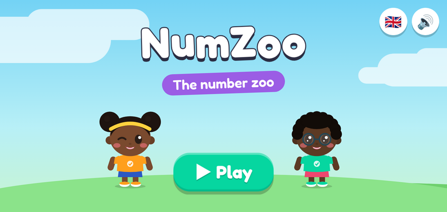
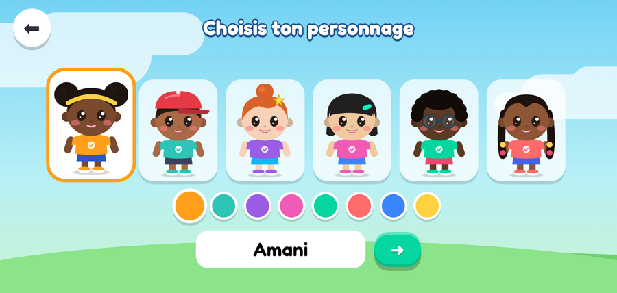
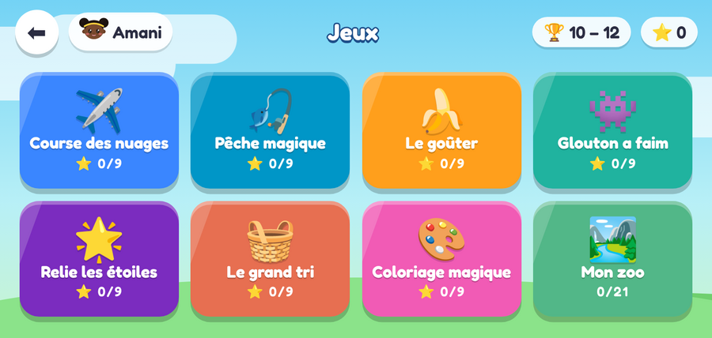
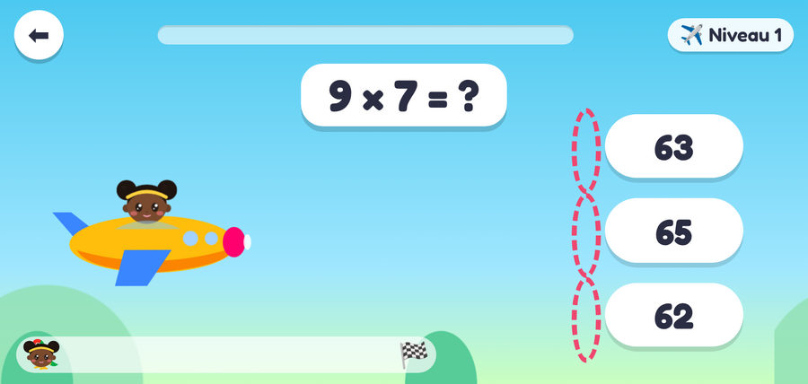
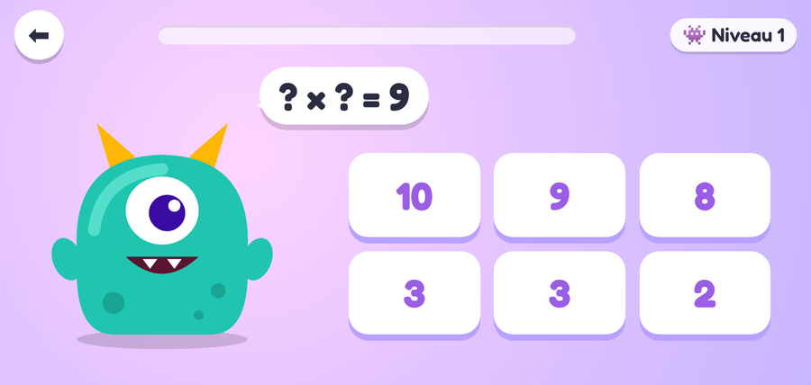
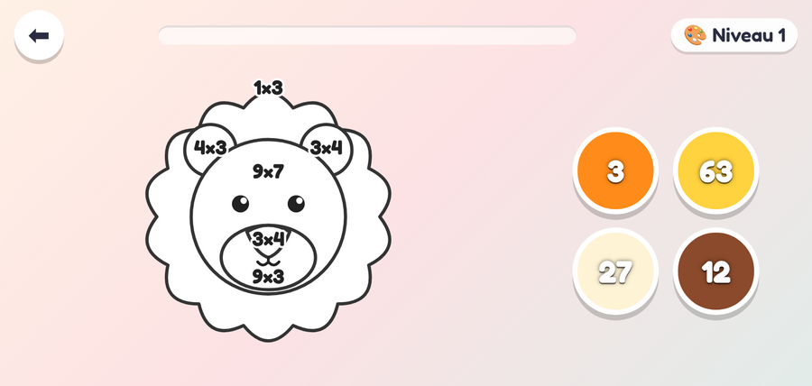

# Cécilia et Manoach — NumZoo

Application éducative de calcul pour enfants de **4 à 12 ans**, sur tablette et téléphone Android, **100 % hors-ligne**.
La version 1 s'appelle **NumZoo** ; les prochaines versions seront construites autour de l'histoire de **Cécilia et Manoach** et de leurs amis **Francesca, Rokaya et Mathias** (voir [docs/HISTOIRE.md](docs/HISTOIRE.md)).


| Accueil | Choix du personnage | Carte des jeux |
|---|---|---|
|  |  |  |
| **Course des nuages** | **Glouton a faim** | **Coloriage magique** |
|  |  |  |

## En bref

| | V1.0 |
|---|---|
| Plateforme | Android 5.0+ (API 21), orientation paysage, plein écran |
| Taille de l'APK | 174 Ko ([releases/NumZoo-V1.0.apk](releases/NumZoo-V1.0.apk)) |
| Technologie | HTML/CSS/JavaScript sans framework, dans une WebView Android native |
| Contenu | 7 jeux × 3 tranches d'âge × 3 niveaux = **63 niveaux** |
| Langues | Français, English, Deutsch, Português, Español, 中文, Lingála |
| Récompenses | Étoiles (1 à 3) et un zoo de 21 animaux à débloquer |
| Données | Stockées sur l'appareil uniquement (aucun réseau, aucune pub, aucune permission) |
| Tests | 63/63 niveaux résolus automatiquement, 0 erreur JavaScript (4 nov. 2026) |

## Les 7 jeux

| | Jeu | Principe |
|---|---|---|
| ✈️ | Course des nuages | Toucher le nuage portant la bonne réponse pour battre le perroquet |
| 🎣 | Pêche magique | Attraper le poisson qui porte la bonne réponse |
| 🍌 | Le goûter | Partager des fruits entre animaux (initiation à la division) |
| 👾 | Glouton a faim | Donner deux nombres dont la somme (ou le produit) fait la cible |
| 🌟 | Relie les étoiles | Relier chaque calcul à son résultat |
| 🧺 | Le grand tri | Ranger les calculs dans le bon panier (plus petit que…, pair/impair) |
| 🎨 | Coloriage magique | Calculer, puis colorier chaque zone avec la bonne couleur |

Le détail des compétences par âge et par niveau est dans [docs/JEUX.md](docs/JEUX.md).

## Organisation du dépôt

```
app/
  www/            Le jeu (HTML, CSS, JS, polices) : c'est tout le contenu de l'APK
  android/        Coquille Android native (WebView), manifeste, icônes, build.sh
  test/           Tests automatisés Playwright + résultats de référence
releases/         APK signés + empreintes SHA-256
docs/             Documentation technique, histoire, feuille de route, captures
.github/          Intégration continue (tests à chaque push)
```

## Démarrer

```bash
# Essayer le jeu dans un navigateur
open app/www/index.html          # ou double-clic sur le fichier

# Lancer les tests
cd app && npm install && npx playwright install chromium && npm test

# Construire l'APK (voir docs/BUILD.md)
export NUMZOO_KS_PASS='…'
bash app/android/build.sh
```

## Documentation

- [Architecture technique](docs/ARCHITECTURE.md)
- [Les jeux et la progression pédagogique](docs/JEUX.md)
- [Construire et signer l'APK](docs/BUILD.md)
- [Tests et preuves de fonctionnement](docs/TESTS.md)
- [L'histoire de Cécilia et Manoach : intégration](docs/HISTOIRE.md)
- [Feuille de route](docs/ROADMAP.md)
- [Journal des versions](CHANGELOG.md)
