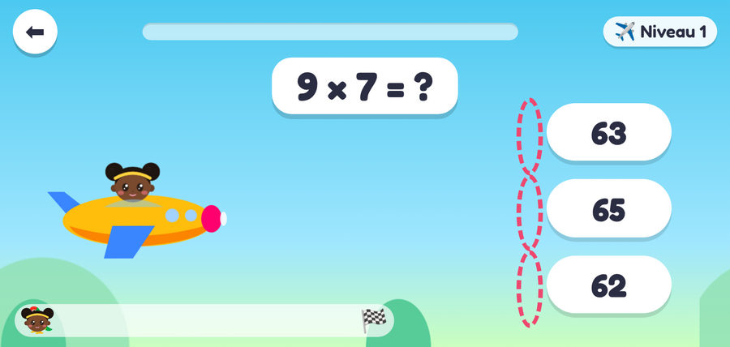
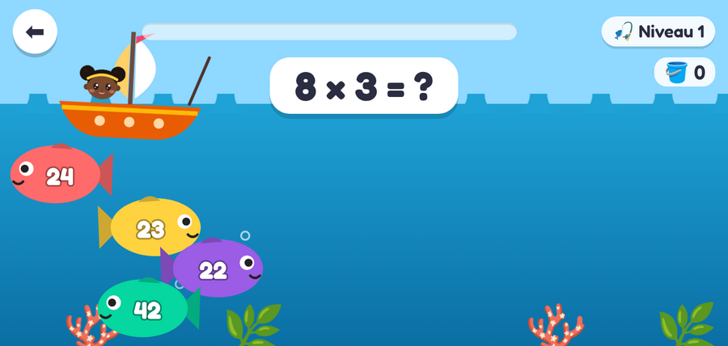
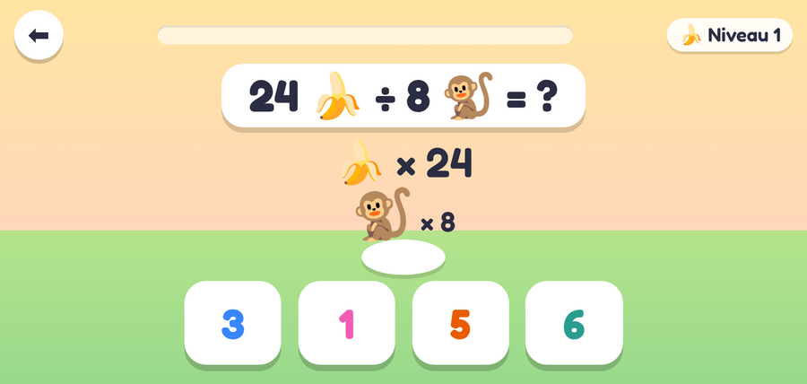
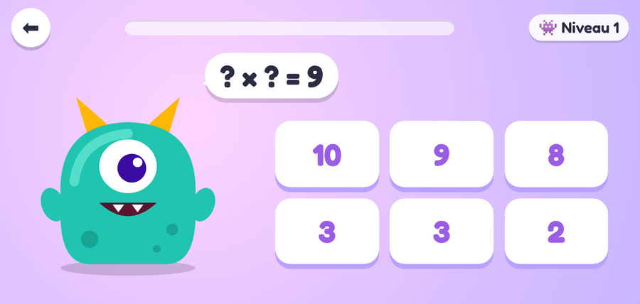
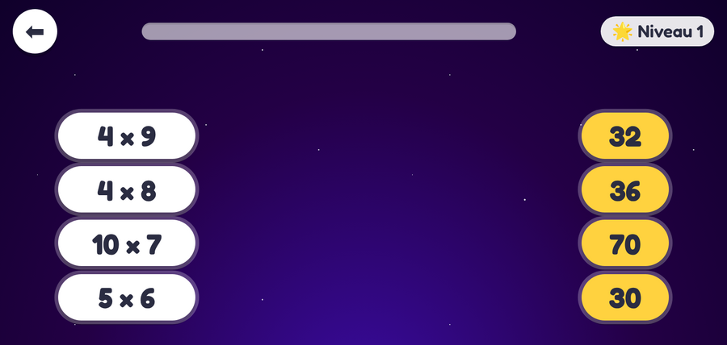
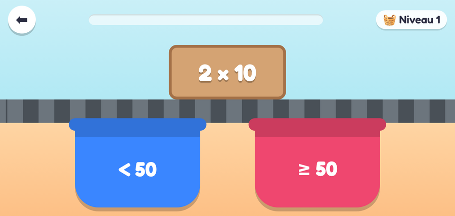
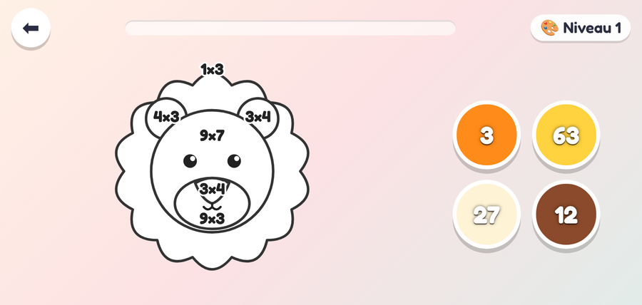
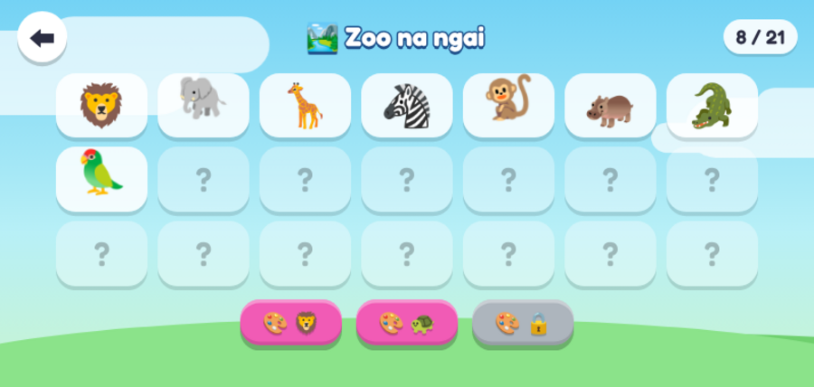
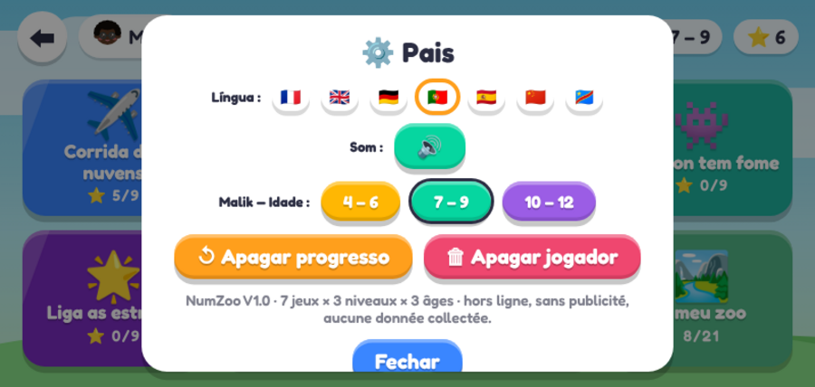
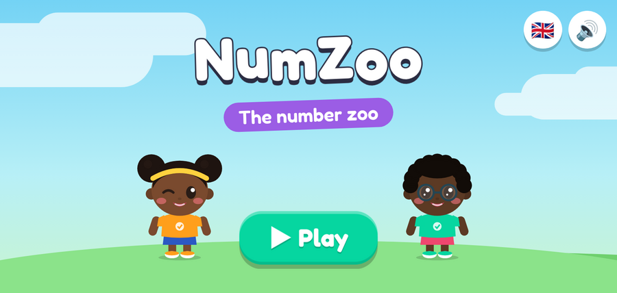

# Tests et preuves de fonctionnement

Les tests pilotent le vrai jeu dans Chromium (Playwright), en écran paysage de téléphone (800 × 380), avec le tactile activé.

## Les scripts — `app/test/`

| Script | Ce qu'il vérifie |
|---|---|
| `structure.js` | Sans navigateur : **10 chapitres, 30 stages, 70 parties** ; chaque partie a une mécanique existante (ou son jeu de repli) et une difficulté pour les 3 âges ; chaque page du livre est débloquable ; chaque image de `img/assets.json` existe (taille ≤ budget) ou a une silhouette. |
| `toutes-les-parties.js` | Un robot résout les **70 parties × 3 âges = 210 manches** dans le vrai jeu, vérifie la célébration et les lucioles. Échoue à la moindre manche bloquée ou erreur JavaScript. Les 3 âges tournent en parallèle. |
| `parcours-ecrans.js [âge] [L×H] [dossier]` | Accueil → langue → profil → personnage → âge → carte → chapitre → stage → une partie par jeu V1 → fin de chapitre → Mon livre. Capture chaque écran. |
| `langues-zoo-parents.js` | Carte en anglais, stage en lingala (repli anglais), livre en chinois, coloriage libre en allemand, porte et espace parents en portugais, célébration en espagnol. |
| `coloriage.js` | Le coloriage magique pour chaque combinaison âge/niveau. |
| `icone.js` | Icône V1 (à remplacer par la petite étoile en phase 6). |

```bash
cd app
npm install
npm test               # structure + 210 manches
npm run test:ecrans    # captures dans app/test/out/
npm run captures       # captures V2 téléphone (800×380) et tablette (1280×800) dans docs/captures/v2/
```

Les mêmes tests tournent automatiquement sur GitHub à chaque push (`.github/workflows/tests.yml`).

## Résultats de référence

V2 phase 1 : voir [app/test/resultats-v2/](../app/test/resultats-v2/).

V1 :

Exécution du **4 novembre 2026** sur le code de la V1.0 : [app/test/resultats-v1/tous-les-niveaux-2026-11-04.txt](../app/test/resultats-v1/tous-les-niveaux-2026-11-04.txt)

| Mesure | Résultat |
|---|---|
| Niveaux réussis | **63 / 63** |
| Erreurs JavaScript | **0** |
| Zoo complété | 21 / 21 animaux |
| Parcours d'écrans | 0 erreur |
| Langues / parents | 0 erreur |

Les fichiers `out_*.txt` du même dossier sont les résultats obtenus lors du développement initial.

## Intégrité de l'APK publié

Le contenu de `releases/NumZoo-V1.0.apk` a été décompressé et comparé fichier par fichier avec `app/www/` : les 8 fichiers (HTML, CSS, 6 scripts) sont **identiques octet pour octet**. L'APK correspond donc exactement au code source de ce dépôt.

| | |
|---|---|
| SHA-256 | `5864e3f0b626ecfbd770464ce8b02c8b808b163c9e9191390fee319a57e4d531` |
| Signature | Certificat `CN=NumZoo, O=NumZoo, C=CD` (fichiers `META-INF/NUMZOO.*`) |

## Galerie

| | | |
|---|---|---|
|  Course des nuages |  Pêche magique |  Le goûter |
|  Glouton a faim |  Relie les étoiles |  Le grand tri |
|  Coloriage magique |  Zoo (lingala) |  Espace parents |
|  Célébration |  Niveaux |  Accueil |
